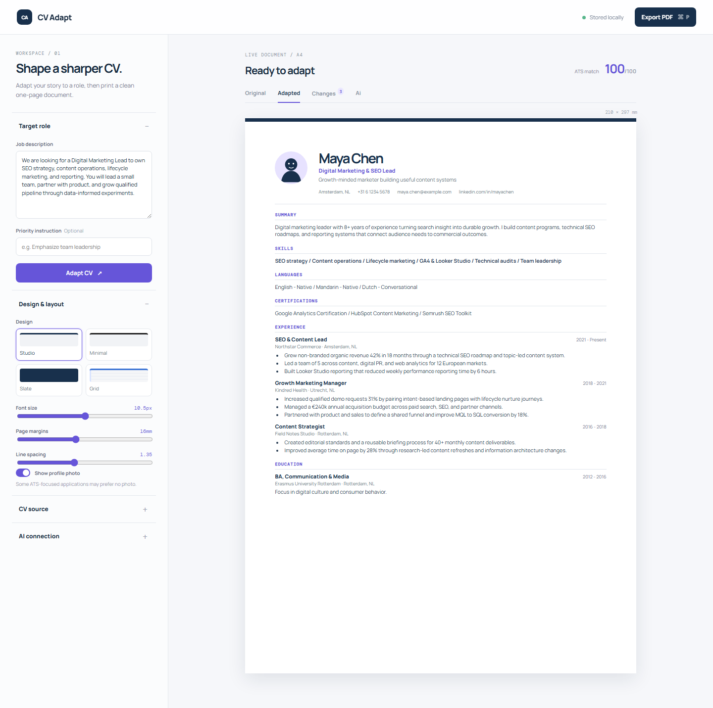
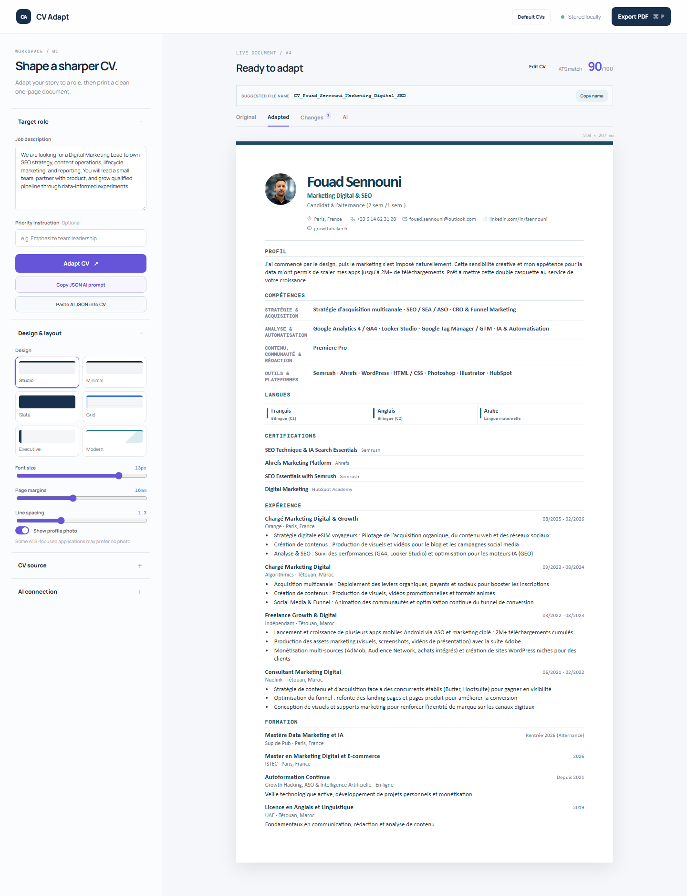

# AI CV Adapt: Open-Source AI Resume & CV Tailoring Engine

A fast, privacy-first web application that adapts your resume to match specific job descriptions, highlights ATS keyword gaps, and exports pixel-perfect single-page PDFs.

- Live Web App: [https://foverse.github.io/ai-cv-adapt/](https://foverse.github.io/ai-cv-adapt/)
- Repository: [https://github.com/foverse/ai-cv-adapt](https://github.com/foverse/ai-cv-adapt)
- Author: [Fouad](https://growthmaker.fr) ([@foverse](https://github.com/foverse))
- Project Hub: [growthmaker.fr](https://growthmaker.fr)
- License: MIT

---

## Why AI CV Adapt?

Most job applicants send a single generic resume to hundreds of postings, or use generic AI tools that hallucinate fake skills and ruin document formatting. 

AI CV Adapt takes a different approach:

1. **Immutable Master CV:** Your actual work experience remains your single source of truth. The engine tailors language, highlights relevant accomplishments, and targets the job description without inventing fictional roles.
2. **ATS Keyword & Gap Detection:** Identifies exact keyword matches and surfaces missing terms required by applicant tracking systems.
3. **Strict Single-Page Fit:** Real-time visual layout guides and dynamic typography controls guarantee your resume stays on exactly one page without awkward page breaks.
4. **100% Client-Side Privacy:** Your personal details, contact information, and career history stay entirely in your local browser storage (`localStorage`). No external databases, no data collection.

---

## Visual Previews

### Application Interface & Adaptation Dashboard


### Real-Time Layout & Single-Page PDF Formatting


---

## Key Features

### 1. Job Description Analysis & Language Detection
- Automatically detects whether the target job posting is in English or French.
- Extracts key technical requirements, tooling, and responsibilities.
- Generates standardized application filenames based on your name and the target role (e.g. `CV_Fouad_Digital_Marketing_Lead.pdf`).

### 2. Live ATS Keyword Alignment
- Compares your resume vocabulary against the posted job requirements.
- Flags covered competencies and highlights gaps to address before submitting.
- Avoids over-optimization and keyword stuffing while ensuring relevance.

### 3. Layout Protection & Typography Controls
- Multiple professional design templates: `Studio`, `Executive`, and `Modern`.
- Dynamic micro-controls for base font size, margin spacing, and line height to fit content onto one page.
- Section toggles to show or hide summary, certifications, languages, or social links depending on the role requirements.

### 4. Dual PDF Export Engine
- Native Browser Print: Single-click print stylesheet (`Ctrl+P`) configured for A4 and Letter dimensions.
- Server-Side Headless Chrome: High-precision PDF export via Puppeteer for consistent cross-browser rendering.

---

## Quick Start

### 1. Clone the repository

```bash
git clone https://github.com/foverse/ai-cv-adapt.git
cd ai-cv-adapt
```

### 2. Install dependencies

```bash
npm install
```

### 3. Start the application

**Vite Frontend Development Server:**
```bash
npm run dev
```

Open `http://localhost:5173` in your browser.

**Optional Backend PDF Server (on port 3016):**
```bash
npm start
```

### 4. Production build

```bash
npm run build
npm run preview
```

---

## Project Structure

```
ai-cv-adapt/
├── index.html                  # Main application shell with SEO meta tags
├── app.js                      # Core adaptation engine, ATS matcher, and state store
├── server.js                   # Express server and Puppeteer PDF renderer
├── style.css                   # Core typography and layout stylesheets
├── enhancements.css            # Responsive panels and template stylesheets
├── refinements.css             # Print media rules and PDF page boundaries
├── assets/                     # Application screenshots and previews
├── public/                     # Static assets, default avatars, and icons
├── default-cv.json             # Sample baseline resume schemas
├── netlify.toml                # Netlify deployment configuration
└── package.json                # Project dependencies and run scripts
```

---

## How to Get the Best Results

1. **Load your base resume:** Edit the personal details, experience, and skills in the app or paste your JSON profile.
2. **Paste the job description:** Copy the complete job posting from LinkedIn, Indeed, or the company careers page.
3. **Review keyword alignment:** Check the surfaced requirements and refine your bullet points to address key competencies.
4. **Adjust layout controls:** Use the margin and font sliders to ensure your document fits within the single-page boundary.
5. **Export to PDF:** Click Export PDF to download your tailored resume ready for submission.

---

## Author & Project Info

Built and maintained by [Fouad](https://growthmaker.fr) ([@foverse](https://github.com/foverse)).

Explore more tools, case studies, and engineering frameworks at [growthmaker.fr](https://growthmaker.fr).

Licensed under the [MIT License](LICENSE).
